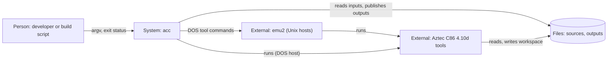
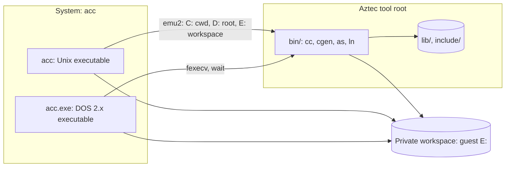
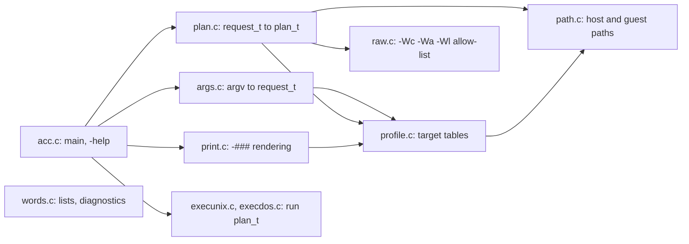
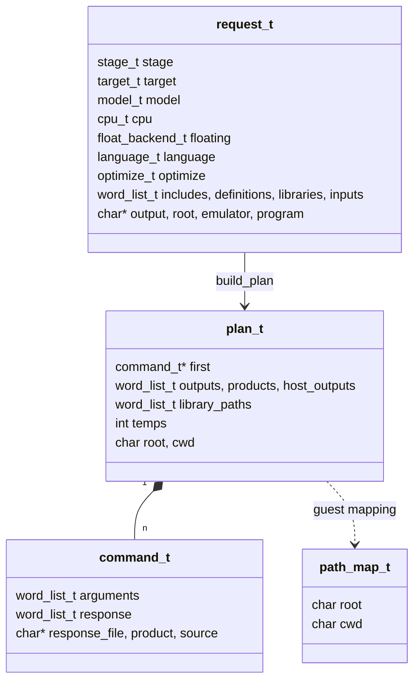

# acc: design

Portable driver for the Aztec C86 4.10d toolchain (labelled 4.3 by
`azdefs.h`). Replaces the `c.exe` driver and the `aztec42_cc`/`aztec42_link`
wrappers; keeps the Aztec compiler, assembler, linker and runtime.

| Document | Content |
| --- | --- |
| [acc.md](../../docs/aztec42/acc.md) | user reference: options, modes, defaults, macros, limits |
| this file | architecture, contracts, decisions, evidence |
| [plan.md](plan.md) | execution history (phases P0-P7, decisions D1-D6) |

## Principles

| # | Rule |
| --- | --- |
| 1 | One output per source; one executable per link |
| 2 | No blind forwarding: every backend flag is managed, allow-listed (`raw.c`) or rejected |
| 3 | Compilation is OS-neutral; the link target follows the `-o` suffix |
| 4 | The driver defines only `__AZTEC__`, OS and CPU macros; the rest is native or `azdefs.h` (guarded by `__AZTEC__`) |
| 5 | Validate everything before running anything; `-###` never touches the filesystem |
| 6 | One C89 source tree for Unix and Aztec C 4.2 on DOS 2; `acc` builds `acc.exe` |
| 7 | Planning is data; the printed plan is the test oracle |

## Build and installation

| Item | Value |
| --- | --- |
| Driver | `make` (Unix and DOS), `make unix`, `make dos`, `make check`, `make install` |
| Unix build | host `cc -std=c89 -pedantic -Wall -Wextra -Werror`, objects in `obj/unix` |
| DOS build | Unix `acc -target=dos2 -DACC_DOS`, objects in `obj/dos`; any Aztec `WARNING` fails |
| Native DOS bootstrap | `build.bat <aztec-root>` (cc/ln directly; not run by `make`) |
| Installed layout | `<root>/bin/acc`, `<root>/bin/acc.exe`, `<root>/include/azdefs.h` |
| Installer | `make install INSTALL_ROOT=<root>`, run by the [fetcher](../fetch/cross_aztec42) |
| Launcher | `bin/aztec43_acc` adds `-toolroot`; it adds no policy |

Portability rules: C89, 16-bit `int`/`size_t`, 64 KB data, no large stack
buffers, null tests against `0` (Aztec's `NULL` is `((void *)0)` and warns
on const pointers), host code only in `path.c` and `execunix.c`/`execdos.c`.

## C4 architecture

One component per source module.

### Level 1: context

### Level 2: containers

| Container | Build | Executor |
| --- | --- | --- |
| `acc` | host `cc -std=c89` | `execunix.c` |
| `acc.exe` | Aztec C 4.2 via `acc` (self-hosted) | `execdos.c` |

### Level 3: components

`words.c` is used by every component (arrows omitted).

| Component | Owns | Never |
| --- | --- | --- |
| `args.c` | option syntax, value lists, macro normalisation | touches the filesystem |
| `profile.c` | flags, startup, runtime, math libraries per target/model/CPU/float | decides policy beyond lookup |
| `raw.c` | backend option allow-list, operand and context checks | forwards an unlisted option |
| `path.c` | canonical paths, guest mapping, DOS 8.3/63-char validation | approximates an unrepresentable path |
| `plan.c` | validation, command emission, link order, response file | creates or modifies files |
| `print.c` | stable `-###` format | evaluates commands |
| `execunix.c` | emu2 launch, workspace, atomic publication, signals | makes planning decisions |
| `execdos.c` | child environment, launch, workspace, backup/restore publication | makes planning decisions |

Interfaces: `request.h`, `plan.h`, `profile.h`, `raw.h`, `path.h`, `acc.h`.

### Level 4: data

| Invariant | |
| --- | --- |
| `plan_t` arguments | guest form only (`C:`, `D:`, `E:`) |
| `E:` | per-invocation private workspace; every temporary is `E:\uNNNN.ext` from one counter, removed at exit |
| Publication | after every command succeeds; all or nothing |
| Ownership | `word_list_t` owns its strings; `free_request`, `free_plan` release all |

## Execution contract

### Guest drives (Unix, emu2)

| Drive | Host | Purpose |
| --- | --- | --- |
| `C:` | invocation directory | sources, outputs, user include/library areas |
| `D:` | tool root | `bin`, `include`, `lib` |
| `E:` | private workspace | every temporary; child `CCTEMP=E:\` |

Every backend-visible path must lie under one of the three; others are
rejected, never copied. Overlapping roots: the deeper anchor wins.
Child environment: `PATH=D:\bin`, empty `INCLUDE` (areas are explicit `-I`),
`CLIB` from the library areas, `EMU2_DEFAULT_DRIVE=C`, `EMU2_PROGNAME`.
Inherited emu2 drive/CWD/program settings are replaced; others (`EMU2_CPU`,
limits, logging) are kept. On DOS, host paths are guest paths.

### Workspace and temporaries

| Rule | Implementation |
| --- | --- |
| One private workspace per invocation | Unix `mkdtemp`; DOS `mktemp` + `mkdir` (atomic claim) |
| Parent | `CCTEMP`, `TEMP`, `TMPDIR`, then `/tmp` (Unix) or cwd (DOS) |
| Temporary names | `E:\uNNNN.ext` from one counter per plan: objects, link product, `.rsm`, `.dbg`, response file |
| Removal | always, including on failure and INT/TERM/HUP (Unix) or Ctrl-C (DOS); DOS enumerates the directory to also remove tool leftovers |
| Retention | `-save-temps` keeps it and prints its path |

### Command lines

| Tool | Limit | Handling |
| --- | --- | --- |
| `cc`, `as` | 126-byte DOS tail | one command per source; overflow is an error before anything runs |
| `ln` | none | always `ln -f <response file>`, CRLF lines |
| any | DOS has no quoting | arguments with blanks or control characters are rejected |
| `acc.exe` itself | 126-byte DOS tail | DOS and emu2 truncate silently, so a full tail (PSP `80h` = 126) is refused; `.inp` carries long link lists |

### Publication and failure

| Rule | |
| --- | --- |
| Order | run every command, verify each product is a non-empty file, then publish all outputs |
| Unix publish | copy beside the destination, then rename: atomic |
| DOS publish | staged copy, backup of the old file, rename, restore on failure |
| Failure | no output is published; existing outputs are untouched |
| Exit status | 0; 1 for driver errors; else the first failing tool's status (`128+N` for signal N) |

## Backend mapping

| Concern | Owner | Detail |
| --- | --- | --- |
| Target, model, CPU, float flags; startup, runtime, math libraries | `profile.c` | docs/aztec42/acc.md "Link target", "Defaults" |
| Raw `-Wc`/`-Wa`/`-Wl` options | `raw.c` | docs/aztec42/acc.md "Backend options" |
| Always emitted | `plan.c` | `cc -b` (no pause), `cc -n` unless `-g` |
| On request | `plan.c` | `-squeeze`: `sqz.exe OBJ` (in place) after each `cc`/`as` command |
| Never emitted | | `cc -3` (K&R), `cc +ej` (unsupported by v4.10d), `ln -N`, `as -ZAP`, foreign ABI modes |

Link argument order (single-pass `ln`): `-o`, overlay `+c +d -r`, raw
options, `-g`, startup, inputs in command-line order, overlay loader or
`.rsm` + `ovbgn.o`, C runtime.

## Decisions

| Id | Decision | Reason |
| --- | --- | --- |
| D1 | `azdefs.h` reports 4.3.0; `__AZTEC_C_VERSION__` is `40300L` | the int formula overflows 16-bit `int` (P6 probe) |
| D2 | link target from the `-o` suffix; explicit `-target` must agree | compilation is OS-neutral |
| D3 | `__CPM86__=1`, `__MSDOS__=1` (dos1) or `2` (dos2) | `__DOS__` was acc-only; `__MSDOS__` carries the DOS major version |
| D4 | no K&R toolchain support | ANSI only |
| D5 | `char` is signed; `CHAR_UNSIGNED` never defined | probe |
| D6 | native ANSI mode only; `-ansi` is rejected | strict mode disables `far`, breaking `dos.h` |
| - | one `.inp` file, no `@file` | single indirection mechanism, link inputs only |
| - | no tiny model | a `.com` is a small-model program |
| - | overlays: small model, `.cmd` or `.exe` root, hex sizes | Tech Info 2.1; `aOO` in the manual is an OCR error for `a00` |

## Evidence

Verified against the v4.10d binaries under emu2; each is an execution test.

| Fact | Test |
| --- | --- |
| `-L` grows the local symbol table; overflow message `Local table full! (use -L)` | `exec-check.sh` raw probes |
| `-y`, `-z` are lowercase; `-E`, `-L` uppercase | golden + raw probes |
| `-k` disables `far`; `-T` writes source comments | raw probes |
| `ln -S`/`-X` take separate hex operands | raw probes |
| `-g` writes `.dbg` for `.cmd` and `.exe` | raw probes, both hosts |
| `cc +ej` (8087 without register saves) is rejected by v4.10d: `unknown option: j`; `-mfloat=8087-fast` removed | `exec-check.sh` (probe history) |
| `as -2` drops the WAITs of 8087 code (355 to 346 bytes); `as` accepts 80186 instructions with or without `-186` | `exec-check.sh` explicit-assembly probes |
| Predefined: `__STDC__ __FILE__ __LINE__ __DATE__ __TIME__ __FUNC__ MPU8086`; no CPU-tier or optimisation signal | P6 probes |
| DOS overlays with an `.exe` root | `exec-check.sh`, `exec-dos-check.sh`, `examples` |

## Tests

| Suite | Target | Scope |
| --- | --- | --- |
| Golden plans | `check-plan`, `check-plan-dos` | `-###` output and diagnostics, `tests/plan/*.cases`, identical on both builds except recorded `@dos` blocks |
| Legacy checks | `check-unix`, `check-dos` | environment, argv and filesystem edge cases |
| Execution | `check-exec`, `check-exec-dos` | build and run under emu2, probes, failures, overlays |
| Coverage gate | `check-coverage` | every option, value, raw option and diagnostic is tested or exempted with a reason (`tests/coverage-exempt.txt`) |
| Self-hosting | `check-self-host` | DOS `acc.exe` plans every module like `acc` and rebuilds a byte-identical `acc.exe` |
| Expectations | `bless` | rewrites golden output from both builds |
