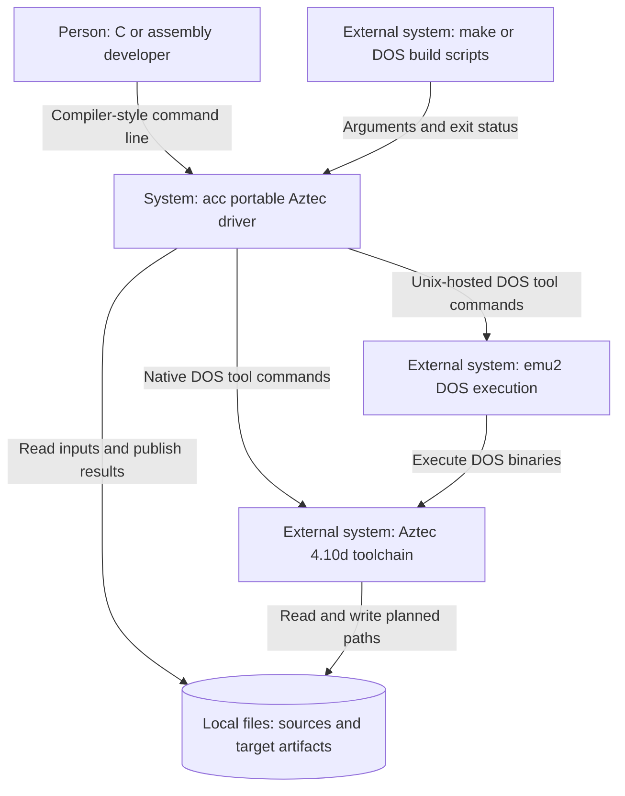
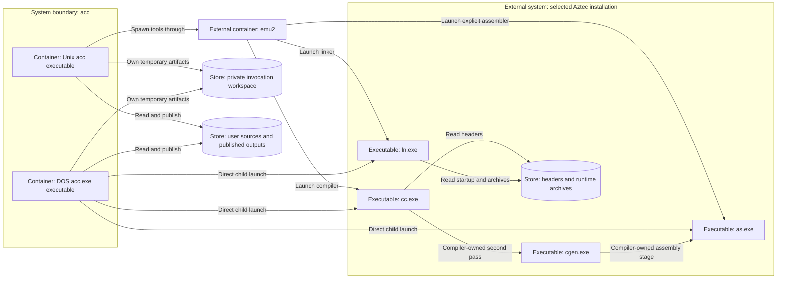
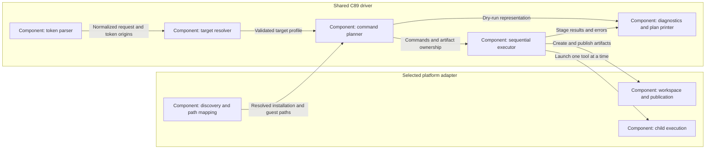
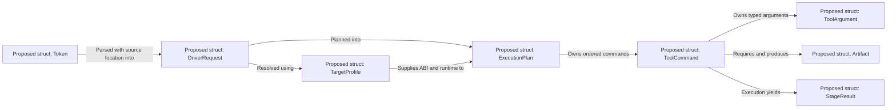

# acc: Aztec C 4.2 compiler driver

## Status and purpose

Replace the orchestration in DOS `c.exe` and the cross-host
`aztec42_cc`/`aztec42_link` wrappers with one portable C driver.
Keep the existing compiler, code generator, assembler, linker, and runtime.

**Current implementation:** a C89 foundation supporting only `-help` and
`-version`, with explicit errors for other invocations. Compilation and
linking through acc are not implemented yet. Everything below describing
the compiler interface is the implementation design, not existing behavior.

## Reading guide

| Section | Question answered |
| --- | --- |
| Build and portability contract | Where can the same source be built and run? |
| CLI decision and detailed interface | What precisely does an invocation mean? |
| C4 architecture | What owns each decision and execution boundary? |
| Backend mapping reference | What is sent to each Aztec tool, and why? |
| Target profiles and linking | Which startup, ABI, and libraries form a program? |
| Platform, paths, and failures | How does identical policy survive different hosts? |
| Implementation sequence | What evidence is required before replacing wrappers? |

The interface is a proposed contract. "Documented" below means described by
the manual, not implemented in acc. "Observed" means present in existing
repository build/test recipes or this foundation's successful builds.
An installed file proves availability, not correctness of every use.

References:

- [Issue #14](https://github.com/tsupplis/cpm86-crossdev/issues/14).
- Aztec C86 4.10 manual: C Driver pages 1-3; Compiler pages cc.7-10,
  cc.19-21; compiler release appendix cc-ap.1-6; Linker pages ln.7-11;
  EXEC/FEXEC library entries.
- Existing [compiler wrapper](../../bin/aztec42_cc),
  [linker wrapper](../../bin/aztec42_link), and
  [runtime regressions](../aztecreg/Makefile).

The installed tools identify themselves as v4.10d; "aztec42" is the
repository's toolchain name. The manual combines original chapters and
release appendices. Verify exact flags against the installed binaries,
not solely an older chapter or OCR transcription.

## Build and portability contract

Use the same conservative C89 source on modern Unix and MS-DOS 2.x or
later, with an 8086-compatible DOS executable built by Aztec itself.

From this directory on Unix:

```
make
make dos
make check
```

`make` builds native `acc`. `make dos` builds `acc.exe` using the existing
cross wrappers and the installed patched small-model DOS runtime.
`make check` tests both executables, running the DOS binary under `emu2`.
`make check-unix` does not require the Aztec installation.
Compiler flags and tool paths can be overridden as make variables.

### Installation location (agreed)

The installed driver belongs in the Aztec installation's `bin` directory,
alongside the backend executables:

- Unix: `<aztec-root>/bin/acc`, a native Unix executable.
- DOS: `<aztec-root>\BIN\ACC.EXE`, a native DOS executable.
- The crossdev repository also exposes a convenience launcher in its own
  `bin` directory. Direct invocation of the installed executable must work
  without that launcher.

The source-tree build outputs described above are development artifacts,
not the final installed layout. Installation/build integration remains a
later implementation step. A launcher locates and executes acc; it must
not duplicate argument translation or emulator/environment policy.

The prerequisite installation cleanup uses a single
[Aztec 4.2 fetch/build entry point](../fetch/cross_aztec42).
The final share tree contains only `bin`, `include`, and `lib`; runtime
sources and build markers live under `archive/aztec42`. The old `c.exe`
driver is deliberately excluded even before acc implements compilation.
Keep the existing raw compiler/linker wrappers available during that
transition. The [runtime installation recipe](../aztec42-patch/README.md)
records the exact retained/excluded tool policy.

On Unix, public paths use host syntax; on DOS they use DOS syntax.
Cross acc translates path-bearing environment settings before launching
DOS tools. DOS acc.exe uses the native DOS values. Search-list delimiters,
fallback ordering, temporary-parent semantics, and handling of inherited
emu2 mappings are being refined separately.

For native DOS, copy this project's sources into a working directory.
For an installation at `C:\AZTEC`:

```
set PATH=C:\AZTEC\BIN;%PATH%
set INCLUDE=C:\AZTEC\INCLUDE
set CLIB=C:\AZTEC\LIB\
build C:\AZTEC
acc.exe -help
acc.exe -version
```

The batch file explicitly extracts startup from `c.lib`, without depending
on the cross wrapper. Its final PASS/FAILED message indicates build success.
The Unix checks additionally verify exit statuses. Cross-building and running
the DOS binary under emu2 does not certify the batch script on native DOS.

Shared code must not use C99 syntax, POSIX types, large stack buffers, or
assume 32-bit `int`. Check allocation arithmetic against 16-bit `size_t`
limits. Start with DOS small model; measure driver size and memory left
for child tools before changing models or introducing restart mechanisms.

## CLI decision: single dash throughout

All options use **one dash**, with case-sensitive spelling.
There are no double-dash aliases. Do not bundle short options: `-cv` does
not mean `-c -v`.

Short options with operands accept attached and separated forms:
`-Iinc` / `-I inc`, `-DNAME=1` / `-D NAME=1`, `-Llib` / `-L lib`,
`-lname` / `-l name`, `-oapp.cmd` / `-o app.cmd`.
Descriptive value options require `=`, such as `-target=cpm86`.
There is no end-of-options marker; use `./-name.c` for Unix filenames
starting with a dash. Unix absolute paths are inputs, not slash-options.

| Option | Meaning |
| --- | --- |
| `-help`, `-version` | Print information and exit; must be used alone |
| `-c` | Compile/assemble to objects without linking |
| `-S` | Compile C to Aztec assembly without assembling or linking |
| `-o file` | Name the final output of the selected stage |
| `-I dir`, `-D name[=value]` | Add an include area or preprocessor definition |
| `-L dir`, `-l name` | Add a library search directory or ordered library input |
| `-target=cpm86`, `-target=dos1`, `-target=dos2` | Select output OS/runtime |
| `-march=i8086`, `-march=i80186`, `-march=i80286` | Select CPU |
| `-mcmodel=small`, `-mcmodel=medium`, `-mcmodel=compact`, `-mcmodel=large` | Select code/data ABI |
| `-mfloat=soft`, `-mfloat=8087`, `-mfloat=8087-fast` | Select floating-point backend |
| `-mfloat=auto` | Select the sensing math library without inline coprocessor code |
| `-ansi`, `-traditional` | Select ANSI-oriented or v3 compatibility mode |
| `-Osize`, `-Ospeed` | Prefer compact or fast code; not GCC optimization levels |
| `-g` | Request Aztec source-level debug artifacts |
| `-w` | Suppress compiler warnings |
| `-nostartfiles` | Omit automatic startup, retain default libraries |
| `-nostdlib` | Omit automatic startup and default libraries |
| `-save-temps` | Preserve intermediates and report their directory |
| `-v` | Print executed commands to stderr |
| `-###` | Print the resolved plan without executing tools |
| `-Wc,arg`, `-Wa,arg`, `-Wl,arg` | Pass one raw argument to compiler, assembler, linker |
| `-toolroot=dir` | Locate the Aztec installation explicitly |
| `-emu=path` | Select emulator executable on Unix only |
| `@file` | Expand driver arguments from a response file |

Defaults: CP/M-86, 8086, small model, software floating point, normal
compiler language mode. Defaults do not depend on host OS or output suffix.
Default executable names are `a.cmd` for CP/M-86 and `a.exe` for DOS.
Explicit DOS `.com` output is allowed subject to linker layout constraints.

`-c` and `-S` are mutually exclusive. A single `-o` with multiple compilation
outputs is an error. Repeated scalar options use the last value; include
directories, definitions, and link inputs retain order. Validate the final
configuration before executing anything.

Unknown options are errors. Do not claim GCC compatibility, modern
optimization levels, modern object formats, or complete ANSI conformance.
Defer `-E`, `-U`, and dependency generation until their implementation is
verified. The manual documents conditional-expression limitations in the
standalone `cpp`; it is not automatically a faithful `-E` implementation.

Raw escape hatches must not override driver-managed target, CPU, model,
or output settings. Inventory backend flags and operand arity; reject
known conflicts rather than allowing a second inconsistent configuration.
Do not guess operand consumption for unknown raw switches.

## Detailed interface contract

### Token grammar and parsing

The same parser consumes DOS arguments, Unix arguments, and expanded driver
response tokens. Shell/DOS command-line decoding happens before this parser;
acc does not re-evaluate shell syntax.

| Token class | Rule | Example |
| --- | --- | --- |
| Exact switch | Match the complete token, including case | `-S`, not `-s` |
| Short option with operand | Operand is the remainder of the token, or the next token | `-Iinc`, `-I inc` |
| Descriptive value option | Split once at the first `=`; value must be nonempty | `-toolroot=C:\AZTEC` |
| Backend argument | Split once after `-Wc,`, `-Wa,`, or `-Wl,`; remainder is one token | `-Wc,-E120` |
| Response reference | `@` followed by a nonempty filename | `@build.rsp` |
| Input | Anything not recognized as an option/reference | `src/main.c` |

Recognize exact descriptive switches before operand-taking short prefixes.
For example, `-nostdlib` is not a short option plus an attached operand.
Reject all tokens beginning `--` explicitly. A bare `-` is invalid: stdin
compilation is not supported initially.

A separate short operand beginning with `-` is diagnosed as missing rather
than consumed as a filename; use an attached operand or a `./` path in that
case. An empty operand is invalid except replacement text after `-DNAME=`.
An operand may contain `=` after its first separator; never split a macro
replacement or pathname repeatedly.

Driver options are global even when placed after inputs. The final target,
model, CPU, language mode, and code preference apply to every compilation.
acc does not provide positional per-source options. Use separate invocations
for different compilation settings.

`-L` directories are global and searched in their specified order, regardless
of where they appear. Objects, explicit libraries, and `-l` inputs are
positional; their relative order is preserved for the linker.

### Precedence, repetition, and defaults

| Setting | Default | Repetition rule |
| --- | --- | --- |
| Target OS | `cpm86` | Last target wins |
| CPU | `i8086` | Last CPU wins |
| Memory model | `small` | Last model wins |
| Floating point | `soft` | Last mode wins |
| Language | Installed compiler's normal mode | Last of `-ansi` / `-traditional` wins |
| Code preference | Installed compiler's default; emit neither preference flag | Last of `-Osize` / `-Ospeed` wins |
| Debug / compiler warnings | Debug off; warnings on | Repeating `-g` or `-w` is idempotent |
| Final output | Stage-derived name | Last `-o` wins |
| Stage | Compile, assemble, link | Repeating the same stage is idempotent; `-c` plus `-S` is an error |
| Tool root | Discovery rules below | Last `-toolroot` overrides environment/discovery |
| Emulator | Installed sibling `emu2`, then PATH lookup | Last `-emu` wins; error on a DOS host |
| Include/search directories | No user entries | Append; do not reorder or silently deduplicate |
| Macro definitions | Selected target macro | Retain order; conflicting repeated definitions are errors |
| Runtime suppression | None | `-nostdlib` dominates `-nostartfiles` |
| Raw arguments | None | Retain order per backend; validate against managed settings |

Do not silently recover from an explicitly specified but invalid tool root
or emulator by selecting a different installation. Scalar last-value-wins
does not suppress validation of malformed earlier tokens.

The driver selects a target macro with value 1:
`__CPM86__=1` for CP/M-86, `__DOS__=1` for either DOS target.
An identical user definition can be accepted as redundant. An opposite
target macro or a conflicting replacement is an error, even if a later
definition would hide it. Do not invent `__unix__` based on the execution host.
Definitions written inside source are outside this command-line check.

### Stage and input matrix

| Input | Default link mode | `-c` | `-S` |
| --- | --- | --- | --- |
| C source `.c` | Compile to private object, then link | Produce object | Produce Aztec assembly |
| Aztec assembly `.asm` / `.s` | Assemble to private object, then link | Produce object | Error |
| Aztec object `.o` | Link in place | Error | Error |
| Aztec archive `.lib` / `-l name` | Search at its ordered position | Error | Error |
| Other suffix, stdin `-`, missing input | Error | Error | Error |

Classify known suffixes case-insensitively, including DOS `.C` and `.ASM`;
retain the actual pathname spelling. No extension guessing or implicit
`.c` suffix. `.S` is assembly, not preprocessed assembly.
Archive-only invocations are errors initially: require at least one source,
assembly, or object input. Path existence and readability are checked before
launching tools.

`-help` and `-version` must each be the sole expanded token. Neither needs
an installed toolchain. Information switches mixed with inputs/options
are errors, not an instruction to abandon the rest of the command.

### Output naming and side effects

| Invocation | Planned final outputs |
| --- | --- |
| `acc main.c` | `a.cmd` in the invocation directory |
| `acc -target=dos2 main.c` | `a.exe` in the invocation directory |
| `acc -c src/main.c` | `main.o` in the invocation directory |
| `acc -S src/main.c` | `main.asm` in the invocation directory |
| `acc -c a.c b.c` | `a.o`, `b.o` |
| `acc -c a.c b.c -o both.o` | Error before execution |
| `acc -c left/x.c right/x.c` | Output-collision error before execution |
| `acc -target=cpm86 main.c -o main.exe` | Target/format mismatch error |

`-o` is the output of the selected final stage, never the temporary object
of a link-mode compilation. In `-c` and `-S` modes a custom output suffix is
permitted because it does not select executable format.
Reject outputs that alias inputs, including case-insensitive DOS aliases.
Do not create missing parent directories.

In multi-output `-c` builds, a completed output may be published before a
later input fails; the invocation is not a transaction across all sources.
On failure, preserve pre-existing outputs for stages that did not complete.
Do not promise to undo successfully published earlier outputs.

`-save-temps` retains owned intermediates, including response files, on success
or failure and prints the workspace location to stderr. It does not change
the stage or authorize deletion of unrelated files.

`-g` requests Aztec debug information, not DWARF. Debug file generation,
linker consumption, and publication under the final basename need a dedicated
probe before enabling this option. Do not equate linker `.sym` output with
source-level `.dbg` information.

### Include paths and definitions

- `-I` applies to C and explicitly assembled inputs; translate the directory
  for the executing DOS tool, not for the output target OS.
- `-DNAME` means `NAME=1`; `-DNAME=` means an empty replacement.
  Validate the name as a C identifier. Function-like command-line macros are
  not supported initially.
- For C, emit a joined `-DNAME=value` token. For assembly, emit the assembler's
  constant-symbol definition form. Reject text replacements that cannot be
  represented as assembler constants; there is no C preprocessor on assembly.
- Target macros also reach explicit assembly as assembler symbols.
  Applying a shared definition to mixed C/assembly inputs must be valid for
  both; otherwise use separate invocations.
- User include directories precede the selected toolchain include directory.
  Existing quoted-include/current-directory semantics must be preserved.
- The manual limits include search areas to eight. Count the effective list
  after installation/current-directory behavior is characterized; fail when
  it exceeds the verified limit rather than dropping directories.
- Backend arguments and paths with spaces require verified DOS serialization
  or alias support. A quoted host token alone does not establish support.

### Language, optimization, and floating point

`-ansi` selects the documented ANSI-oriented behavior, including disabling
non-ANSI keywords such as `near` and `far`. It does not certify full C89.
`-traditional` selects v3.40b-compatible preprocessing/expression rules; it
does not run the Aztec 3.4 compiler or replace the 4.10 runtime.

`-Osize` maps only to compact-code preference; `-Ospeed` maps only to
fast-code preference. There is deliberately no `-O0`, `-O1`, `-O2`, `-O3`,
`-Os`, or `-Ofast` compatibility claim. Neither preference disables the
compiler's optimizer.

| Floating-point mode | Generated arithmetic | Runtime family selected by `-lm` | Hardware contract |
| --- | --- | --- | --- |
| `soft` | Normal helper calls; no inline coprocessor option | `m` | No coprocessor required |
| `auto` | Normal helper calls; no inline coprocessor option | `m87s` | Sensing library chooses hardware or software at runtime |
| `8087` | Compiler `+e` | `m87` | Coprocessor required; save/restore registers when necessary |
| `8087-fast` | Compiler `+ej` | `m87` | Coprocessor required; caller explicitly accepts register-reuse risk |

The manual warns that `+ej` can produce incorrect results when live
coprocessor registers are reused. It must never be selected implicitly.
`m87s` means sensing, not the unsafe fast mode.
`i80286` plus inline hardware arithmetic selects the documented 80287
assembler behavior; verify exact emitted instructions and target hardware.
Selecting a float mode does not automatically add `-lm`: the user must
request math linkage if compiler helpers or math/formatting functions need it.

### Library and runtime interface

`-lfoo` searches for exactly `foo.lib`, not `libfoo.a`, ELF libraries, or
Microsoft OMF archives. `-L` never changes the compiler's table size.
Resolve an explicit `.lib` pathname directly; do not search for it.

`-lm` is the one profile-aware library alias. Its resolved archive stays at
the original input position, and automatic libc is appended after user
inputs. Users must put dependent archives after the objects/libraries that
reference them. acc does not fix bad ordering by moving libraries.

Reserve C runtime names `c`, `c86`, `d11`, `cl`, `clc`, and `cld` in `-l`
form: diagnose them and recommend selecting the target/model instead.
This prevents duplicate/conflicting automatic runtimes.
For expert custom runtime links use `-nostdlib` and explicit `.lib` paths.
Reject recognized stock runtime paths inconsistent with the active profile;
arbitrary renamed archives cannot be ABI-validated by filename.

`-nostartfiles` removes only the injected startup. `-nostdlib` removes both
injected startup and automatic C library, but does not remove explicit user
objects, archives, or `-lm`. The profile still controls compilation and the
executable format. The user must supply a valid entry point and any helpers
needed by compiler-generated code.

### Raw backend arguments

Each `-Wc,`, `-Wa,`, or `-Wl,` occurrence contributes exactly one argument.
Do not implement comma-list splitting: it makes commas inside values and
paths ambiguous. The remainder after the prefix is literal, including any
further commas. Empty remainders are errors.

For an allowed native option with a separate operand:

```
acc -target=dos2 main.o -Wl,-s -Wl,400 -o main.exe
```

The raw validator must consume those tokens using the native option's known
arity and validate hexadecimal syntax/range. A standalone raw operand with
no owning option is an error. File-bearing native flags are not generic
escape routes: acc must understand their path translation and ownership.

Compiler raw arguments apply to each C compilation. Assembler raw arguments
apply only to explicit assembly invocations; they do not automatically reach
the assembler started internally by `cc`. Reject `-Wa` if no explicit
assembly input exists. Reject `-Wc` if no C input exists and `-Wl` when
linking is disabled.

Use the allowlist in the mapping reference below. Unsupported or
unclassified native flags are errors, not unchecked forwarding.

### Response-file grammar

Expand `@file` in place before interpreting options; preserve token order
and origin filename/line for diagnostics. Accept space, tab, LF, and CRLF
as whitespace. Double quotes group token fragments; adjacent quoted and
unquoted fragments form one token. Backslashes are always literal.
Empty quoted tokens survive lexical analysis and then fail semantic checks
where an empty operand/input is invalid.

No nested response files, comments, shell expansion, wildcard expansion,
or environment interpolation. Reject NUL bytes and unterminated quotes.
Resolve all relative paths against the invocation directory, not the
response file's directory. A leading literal `@` pathname must be written
as `./@name`; quoting does not disable reference expansion.

Driver `@file` is distinct from linker `-f`: acc parses the former, validates
the complete request, and generates its own linker response file if needed.
Never forward an uninspected user linker response file.

### Diagnostics, dry runs, and environment

`-v` prints the normalized profile, invoked tool commands, and generated
response-file content to stderr. It does not enable native linker verbosity.
`-###` prints the same resolved plan without launching tools, creating
workspaces, or writing outputs. It may read inputs, installations, and
response files to resolve the request. Missing tools/libraries remain errors.
Use symbolic workspace names in dry-run output.

Command displays are diagnostic representations, not shell scripts.
Show argument boundaries unambiguously, including empty arguments, and
distinguish host paths from DOS paths. Do not dump the inherited environment.

| Environment | Policy |
| --- | --- |
| `ACCROOT` | Tool root fallback, below `-toolroot` |
| `PATH` | Locate acc/emulator on Unix; construct a backend PATH for the selected installation |
| `TMPDIR` on Unix, `TEMP` on DOS | Workspace parent; invalid explicit parent is an error |
| `INCLUDE`, `CLIB`, `CCTEMP` | Honor caller configuration; cross acc translates host paths and constructs/adjusts DOS child values, while DOS acc.exe uses native values |
| `EMU2_DRIVE_*`, `EMU2_PROGNAME`, `EMU2_APPEND` | Adapter must construct a coherent child mapping; policy for reusing inherited mappings remains an interview decision |
| `AZTEC_STARTUP`, `AZTEC_NOSTARTUP` | Legacy wrapper settings, not acc configuration; diagnose if set during acc execution |

No implicit flags from `CFLAGS`, `LDFLAGS`, or a configuration file.
Build tools pass their chosen arguments explicitly.

Examples of proposed diagnostics:

```
acc: option -target requires a nonempty value after '='
acc: -S cannot be combined with -c
acc: compact model is not supported for target cpm86
acc: output main.exe conflicts with target cpm86; expected .cmd
acc: compiler command exceeds the verified DOS command-tail limit
acc: compile failed for src/main.c: cc.exe exited with status 1
```

### Worked invocations

All commands in this subsection describe the future interface.
`DOS(path)` below denotes path translation, not literal command syntax.

| Request | Essential plan |
| --- | --- |
| `acc hello.c -o hello.cmd` | Compile with `+0`, `-b`, `-n`, `-D__CPM86__=1`; link `begin86.o`, private object, `c86.lib` |
| `acc -c -I inc -DDEBUG src/main.c -o main.o` | Compile once to owned object; publish `main.o`; no linker |
| `acc -S -ansi main.c -o main.asm` | Compiler `-A -ansi`; publish assembly; no assembler/linker stage |
| `acc -target=dos2 -mcmodel=large main.c -lm -o main.exe` | Compile with `+l`; link `lbegin.o`, object, `ml.lib`, `cl.lib` |
| `acc -target=dos2 -mfloat=auto main.o -lm -o main.exe` | No compilation; link `sbegin.o`, `main.o`, `m87s.lib`, `c.lib` |
| `acc -nostdlib entry.asm -o bare.cmd` | Assemble; link only the resulting object; no automatic runtime |
| `acc @app.rsp -###` | Expand and validate response tokens; display plan without creating files |

Illustrative direct backend arguments for the first command:

```
cc.exe +0 -b -n -D__CPM86__=1 -o DOS(work/u0001.o) DOS(hello.c)
ln.exe -o DOS(work/result.cmd) DOS(lib/begin86.o) DOS(work/u0001.o) DOS(lib/c86.lib)
```

Backend output spelling `-o` is observed in repository recipes; some manual
OCR renders letter O as zero. Neither `-0` nor uppercase aliases become
public acc options.

## C4 architecture

These are **proposed C4 views**, rendered with ordinary Mermaid flowcharts
for broad Markdown support rather than experimental Mermaid C4 syntax.
Labels explicitly identify people, systems, containers, and components.
Only the information-option foundation exists today.

### Level 1: system context

<!-- mermaid-checked: no \n, no em-dash/en-dash, no {} in labels, subgraphs are id["label"], arrows are -->|"label"|, all subgraphs closed by end, ids unique -->


The system boundary is driver policy and orchestration. Compilation,
assembly, and executable generation stay outside it. There are no network
services, databases, or cloud dependencies.

### Level 2: containers and execution boundaries

In C4, a container is an executable or data store, not necessarily Docker.
The two acc executables are alternative deployments of the same source,
not two simultaneously required services.

<!-- mermaid-checked: no \n, no em-dash/en-dash, no {} in labels, subgraphs are id["label"], arrows are -->|"label"|, all subgraphs closed by end, ids unique -->


The pass arrows denote the compiler-owned pipeline, not a promise about its
private process-replacement protocol. acc uses only the supported `cc`
interface. The linker consumes planned intermediate objects from the
workspace; the driver publishes only completed outputs.

### Technology stack summary

| Layer | Technology | Version/constraint | Purpose |
| --- | --- | --- | --- |
| Shared driver | C | C89 subset accepted by Aztec | CLI, target policy, planning |
| Unix adapter | Native process/filesystem APIs | Per supported Unix host | Run emu2 and translate paths |
| DOS adapter | Aztec runtime and DOS child APIs | DOS 2.x+, 8086 baseline | Run DOS tools and collect status |
| Backend | Aztec compiler/assembler/linker | Installed v4.10d | Generate target artifacts |
| Cross execution | emu2 | Repository-installed implementation | Execute DOS backend on Unix |
| Persistent data | Local filesystem | Host/DOS representation limits | Sources, installation, outputs |

Architectural decisions:

- Shared policy is independent of host execution and output target OS.
- Private compiler passes remain backend-owned.
- Filesystem ownership and explicit failures are part of the driver contract.

### Level 3: components inside either acc executable

<!-- mermaid-checked: no \n, no em-dash/en-dash, no {} in labels, subgraphs are id["label"], arrows are -->|"label"|, all subgraphs closed by end, ids unique -->


### Component inventory and dependency rules

| Component | Responsibility | Must not do |
| --- | --- | --- |
| Token parser | Expand responses, validate grammar, retain input order/origins | Launch tools or infer target from libraries |
| Target resolver | Apply defaults, validate ABI combinations, select runtime/macros | Probe arbitrary libraries by executing them |
| Command planner | Map options, assign artifacts, preserve link order, check limits | Run a second inconsistent command generator |
| Sequential executor | Run dependency-ordered stages, stop on failure | Continue after failed compilation |
| Diagnostics/plan printer | Render argument boundaries, profile, errors | Evaluate displayed commands as shell text |
| Discovery/path mapping | Locate tools and translate typed path operands | Rewrite arbitrary macro text |
| Workspace/publication | Own temporary files, protect existing outputs | Delete user files or assume Unix rename on DOS |
| Child execution | Serialize/launch tool arguments and return status | Make target/model policy decisions |

These are responsibility boundaries, not a requirement for eight source
files or dynamic dispatch. Select the platform at build time with narrow
interfaces and compile-time conditionals. No plugin loading or host shell
dependency is needed.

### Level 4: conceptual code/data model

This view constrains implementation data ownership. These types do not yet
exist in the foundation; it is not a reverse-engineered class diagram.
Use C structs, tagged enums, and bounded heap-owned arrays, not C++ classes.

<!-- mermaid-checked: no \n, no em-dash/en-dash, no {} in labels, subgraphs are id["label"], arrows are -->|"label"|, all subgraphs closed by end, ids unique -->


| Proposed type | Essential fields/invariants |
| --- | --- |
| `Token` | Text, argv/response origin, line; owned until request construction finishes |
| `DriverRequest` | Stage, scalar settings, ordered inputs/definitions/paths/raw tokens; no guest paths |
| `TargetProfile` | Target, CPU, model, float mode, macro, startup, C/math archive names; immutable after validation |
| `ExecutionPlan` | Ordered commands, artifact list, requested publications; same input to dry-run and execution |
| `ToolCommand` | Tool identity, typed argv, child environment, working directory, prerequisite/output artifact IDs |
| `ToolArgument` | Literal, joined-option path, or separate path operand; never guess translation from text |
| `Artifact` | Host/guest representation, owner, format suffix, temporary/final role, publication state |
| `StageResult` | Launch failure versus exit code versus abnormal termination; never success-shaped fallback |

Use checked counts and allocations suitable for 16-bit builds. Free request,
plan, and workspace resources through explicit lifetime owners; do not rely
on process exit for publication/cleanup correctness.

## Backend mapping reference

Parsing, target selection, and planning are shared, platform-independent C.
Use straightforward structs/functions; split files when implemented
responsibilities warrant it, not to create a plugin framework.
Commands carry argument vectors, working directories, environment settings,
expected outputs, and cleanup ownership. Dry-run prints this same plan.

### Backend stages

- `.c`: invoke `cc.exe`, which starts `cgen.exe` and normally `as.exe`.
- `.asm` / `.s`: invoke Aztec `as.exe`; `.s` does not imply GNU syntax.
- `.o`: pass an Aztec-format object directly to the linker.
- `.lib`: pass an Aztec archive at its original link position.
- Reject other suffixes initially.

Keep the supported compiler interface; do not invoke the private `cgen`
protocol directly. Compiler `-A` implements driver `-S`; driver `-c` simply
omits the final link.

`-S` accepts C inputs only. `-c` accepts C and assembly inputs only.
Reject link-only inputs in these modes rather than silently dropping them.
Without `-o`, compilation-only outputs use the input basename in the current
directory; reject basename collisions before execution. Link-mode
intermediate objects belong to the private workspace.

### Evidence and implementation gates

| Mark | Meaning | Required before exposing the translation |
| --- | --- | --- |
| Observed | Existing repository build/check uses this behavior | Add acc plan tests and integration coverage |
| Documented | Manual gives the behavior; not necessarily exercised here | Probe installed binary, then add plan/integration tests |
| Pending | Exact propagation, artifact naming, or serialization is unresolved | Reject until qualification; never silently degrade |

These are not feature flags that permit partial execution. If an invocation
needs a pending capability, diagnose it before launching any stage.
The current foundation rejects all compilation requests regardless of mark.

### Driver-to-tool mapping matrix

Backend spellings below use lowercase where repository recipes establish
them; manual uppercase spellings are retained in the native-option inventory.
Do not assume the backend is case-sensitive or case-insensitive without a
probe. acc itself is always case-sensitive.

| Public option/setting | Compiler invocation | Explicit assembler invocation | Linker/driver action | Evidence |
| --- | --- | --- | --- | --- |
| Default link mode | `cc` writes a private object | `as` writes a private object | Link ordered inputs with profile startup/libc | Observed stages; acc orchestration planned |
| `-c` | Normal compile/assemble, explicit object output | Explicit object output | No linker | Observed backend outputs |
| `-S` | `-A -o path` | Not invoked | Publish assembly | Documented |
| `-o path` | `-o` plus translated owned output | `-o` plus translated owned output | `-o` plus correctly suffixed private executable, then publish | Observed spelling; publication planned |
| `-I path` | Joined `-I` plus translated directory | Joined `-I` plus translated directory | No linker flag | Documented; compiler observed |
| `-D name=value` | Joined `-Dname=value` | Joined `-Dname=constant`, constant-only contract | No linker flag | Documented; compiler/assembler used in tests |
| `-L path` | None | None | Search path in resolver; emit resolved archive path | Driver policy |
| `-l name` | None | None | Ordered resolved `name.lib`; `m` is profile-aware | Observed linker libraries; driver resolution planned |
| `-target=cpm86` | `-D__CPM86__=1` | Same target symbol | `begin86.o`, `c86.lib`, `.cmd` | Observed runtime; macro policy planned |
| `-target=dos1` | `-D__DOS__=1` | Same target symbol | `begin11.o`, `d11.lib`, `.exe`/`.com` | Observed runtime; macro policy planned |
| `-target=dos2` | `-D__DOS__=1` | Same target symbol | Model-specific runtime, `.exe`/`.com` | Observed runtime; macro policy planned |
| `-march=i8086` | `+0` | No 80186/80287 enable flag | No linker CPU flag | Compiler observed; assembler baseline documented |
| `-march=i80186` | `+1` | `-186` | No linker CPU flag | Documented; explicit assembly needs probe |
| `-march=i80286` | `+2` | Exact integer-instruction support pending | No linker CPU flag | Compiler documented; explicit assembly pending |
| `-mcmodel=small` | Omit large-model flags | No universal model flag | Small-model startup/runtime | Observed |
| `-mcmodel=medium` | `+lc` | Source must use matching ABI | `beginlc.o`, `clc.lib` | Observed |
| `-mcmodel=compact` | `+ld` | Source must use matching ABI | `beginld.o`, `cld.lib` | Observed |
| `-mcmodel=large` | `+l` | Source must use matching ABI | `lbegin.o`, `cl.lib` | Observed |
| `-mfloat=soft` | Omit inline floating-point flags | Do not rewrite instructions | `-lm` resolves to software family | Observed |
| `-mfloat=auto` | Omit inline floating-point flags | Do not rewrite instructions | `-lm` resolves to sensing family | Library family observed; runtime hardware choice documented |
| `-mfloat=8087` | `+e` | Source supplies instructions; CPU-dependent 80287 policy | `-lm` resolves to hardware family | Compiler/library link observed; assembly propagation pending |
| `-mfloat=8087-fast` | `+ej` | Same explicit-source constraints | Hardware family; no automatic unsafe opt-in | Documented; runtime tests required |
| `-ansi` | `-ansi` | None | No runtime replacement | Documented |
| `-traditional` | `-3` | None | No runtime replacement | Documented |
| `-Osize` | `+c` | None | No automatic `sqz` | Documented |
| `-Ospeed` | `+f` | None | No automatic `sqz` | Documented; repository uses `+F` |
| `-g` | Omit debug-disabling `-n` | No assumed source-level debug equivalent | Track/publish verified debug files | Pending end-to-end debug qualification |
| No `-g` | `-n` | No assumed debug switch | Do not request debug outputs | Observed in foundation build |
| `-w` | `-s` | None | Does not suppress linker warnings | Documented |
| Every C compilation | `-b` | None | Ensure no interactive error prompt | Observed; also patched in installed compiler |
| `-nostartfiles` | Unchanged | Unchanged | Omit automatic startup only | Driver policy |
| `-nostdlib` | Unchanged | Unchanged | Omit automatic startup/libc; retain explicit inputs | Driver policy |
| `-save-temps` | Explicit owned output names | Explicit owned output names | Retain workspace and report path | Driver policy |
| `-v` / `-###` | No native verbosity flag | No native verbosity flag | Display plan / display without execution | Driver policy |
| `-toolroot` / `-emu` | No native flag | No native flag | Discovery/execution settings only | Driver policy |
| `@file` | Do not forward | Do not forward | Expand driver tokens; serialize linker response if needed | Driver policy; linker response usage observed |

Large-model and floating-point selection cannot transform handwritten
assembly or prebuilt objects. Document the ABI obligation; do not emit
invented assembler model options.

Aztec compiler `-E`, `-S`, and `-L` mean expression-table size, warning
suppression, and local-symbol-table size. Never blindly forward cc-style
arguments. Preserve case when emitting backend arguments.
Probe floating-point flags, assembler switches, and debug artifact handling
before implementing their translations.

### Native compiler option disposition

This inventory covers the optimizing 4.10 compiler, including release
appendices. It is not a request to expose all native flags as acc options.
The table's raw routes are planned allowlist entries, subject to binary
qualification. Value-bearing numeric raw options require positive decimal
values representable by the backend and safe command serialization.

| Native compiler option | Native meaning | acc treatment |
| --- | --- | --- |
| `-A` | Do not start assembler | Managed by `-S`; reject raw override |
| `-O file` | Alternate object/assembly output | Managed by `-o`; reject raw override |
| `-Dsymbol[=text]` | Define macro | Managed by `-D`; reject raw override |
| `-Idir` | Add include area | Managed by `-I`; reject raw override |
| `-S` | Suppress warnings | Managed by `-w`; reject raw override |
| `-B` | Do not pause after errors | Always enabled; reject raw attempt to alter interaction |
| `-T` | Add source statements as assembly comments | Allow `-Wc,-T` only with `-S`; otherwise defer side artifacts |
| `-Ecount` | Expression work-table entries | Allow joined `-Wc,-E120`; no relation to preprocessing |
| `-Lcount` | Local-symbol-table entries | Allow joined `-Wc,-L100`; no relation to library search |
| `-Ycount` | Outstanding switch-case entries | Allow joined `-Wc,-Y200` after exact-spelling probe |
| `-Zbytes` | Literal string-table capacity | Allow joined `-Wc,-Z4000` after exact-spelling probe |
| `-ansi` | ANSI-oriented mode | Managed by `-ansi` |
| `-3` | v3.40b-compatible rules | Managed by `-traditional` |
| `-c` | Toggle prototype-conversion warnings | Defer toggle semantics; not driver `-c` |
| `-k` | Disable extended keywords | Allow raw after qualification; does not select full ANSI mode |
| `-ze` | Microsoft-compatible near/far/huge behavior | Defer foreign-compiler ABI mode |
| `-n` | Disable source-debug information | Managed by debug policy; reject raw override |
| `+F` / `+C` | Fast/compact code preference | Managed by `-Ospeed` / `-Osize` |
| `+0` / `+1` / `+2` | 8086/80186/80286 generation | Managed by `-march` |
| `+LC` / `+LD` / `+L` | Large-code/data combinations | Managed by `-mcmodel` |
| `+e` / `+ej` | Inline coprocessor code, safe/unsafe register handling | Managed by `-mfloat` |
| `+N` | Save register variables around calls to foreign code | Defer cross-compiler integration; not automatic ABI compatibility |
| `+D` / `+DF` | Lattice long-return interface conventions | Defer foreign-compiler ABI modes |
| `+U` | Convert uninitialized globals to externs | Allow raw after qualification; user owns declaration consistency |
| `+R` | Disable inter-statement register tracking | Allow raw; not equivalent to disabling all optimization |
| `+A` | Assert absence of certain assignment aliases | Allow raw only as an explicit user assertion |
| `+M` | Force multiply instruction for constant multiplication | Allow raw after qualification |
| `+s` | Place strings in code for large-data models | Allow raw only with compact/large data and qualified runtime behavior |
| `+b` | Generate stack-overflow checks | Allow raw only with a compatible linked/custom runtime |

Do not copy `ccb`/Personal-system meanings into the optimizing compiler
profile: the manual assigns different behavior to non-optimizing `+F` and
provides a non-optimizing `+J`. They are outside this project's backend.
Do not reuse obsolete numeric table defaults printed in older chapters:
the manual contains inconsistent count/byte examples.

### Explicit assembler mapping and restrictions

| Native assembler option | Native meaning | acc treatment |
| --- | --- | --- |
| `-Oobjfile` | Output object path | Driver-managed `-o`; use verified token form |
| `-ZAP` | Delete assembly source after assembling | Forbidden for user sources; acc owns temporary cleanup |
| `-186` | Enable 80186 instructions | Managed by `-march=i80186`; verify 286 requirements separately |
| `-2` | 80287 mode without inserted WAIT | Managed CPU/hardware policy, not a generic 80286 CPU flag |
| `-Sn` | Number of squeeze passes | Allow joined raw `-Wa,-S3` after bounds/behavior probe |
| `-Idir` | Include search area | Managed by `-I` |
| `-Dsym[=const]` | Define constant symbol | Managed by `-D` |
| `-L`, `-LA`, `-LS` | Listing files with differing macro detail | Defer until listing artifacts are explicitly owned/published |
| `-C`, `-CA`, `-CS` | Listing to console | Allow raw only after diagnostic stream behavior is qualified |
| `-X` | Omit false conditionals from listings | Defer until supported listing mode exists |

`-Wa` does not tunnel into compiler-owned `as` execution. If a feature needs
that control, implement an explicitly owned compile-to-assembly stage first
and prove it preserves existing semantics; do not silently change the
pipeline based on a raw argument.

### Native linker option disposition

| Native linker option | Native meaning | acc treatment |
| --- | --- | --- |
| `-O file` | Output executable; suffix selects format | Managed by `-o` and target validation |
| `-Lname` | Locate `name.lib` through CLIB | Driver resolves `-l`; never forward Unix `-Ldir` |
| `-F file` | Merge linker arguments | Driver-generated response only; reject user raw form |
| `-T` | Generate text `.sym` symbol table | Defer until side-artifact publication is implemented; not `-g` |
| `-M` | Suppress permitted multiple-global warnings | Allow explicit raw after qualification; never default |
| `-N` | Generate output despite undefined symbols | Forbidden: violates successful-link contract |
| `-S hexbytes` | DOS minimum stack/heap loader allocation hint | Allow raw with DOS target; not a precise runtime stack-size setting |
| `-X hexparas` | DOS 2.x EXE maximum stack/heap allocation hint | Allow raw only for dos2 `.exe`; 16-byte paragraph units |
| `-V` | Linker progress output | Allow raw; distinct from driver command tracing |
| `-B hexaddr` | DOS COM base address | Deferred custom layout |
| `-C hexaddr`, `-D hexaddr`, `-U hexaddr` | Segment origins / ROM or COM placement | Deferred custom layout |
| `-R` | Overlay root symbol table | Deferred overlay workflow |
| `+C hexbytes`, `+D hexbytes` | Reserve overlay code/data areas | Deferred overlay workflow |

Native numeric units are part of the interface. In particular, do not call
linker `-S` a reliable runtime stack-size setting: the manual says startup
variables also govern allocation. Do not equate hexadecimal bytes with
paragraphs or silently parse these raw operands as decimal.

### Legacy wrapper/driver migration map

| Existing request | Proposed acc equivalent | Intentional difference |
| --- | --- | --- |
| `aztec42_cc file.c` | `acc -c file.c` | Bare acc links by default; wrapper only compiles |
| `aztec42_cc -A file.c` | `acc -S file.c` | Public stage switch is cc-like |
| `aztec42_cc +F +0 -I. file.c` | `acc -c -Ospeed -march=i8086 -I. file.c` | No top-level native plus options |
| `aztec42_cc +lc file.c` | `acc -c -target=dos2 -mcmodel=medium file.c` | Target and model become explicit policy |
| `aztec42_link -o app.cmd app.o -lm -lc86` | `acc -target=cpm86 app.o -lm -o app.cmd` | Runtime/startup come from profile |
| `aztec42_link -o app.exe app.o -lml -lcl` | `acc -target=dos2 -mcmodel=large app.o -lm -o app.exe` | Generic math alias is model-aware |
| `c -c file.c` | `acc -c file.c` | Similar stage behavior, not a claim of full c.exe compatibility |
| `c -f files` | `acc @files` | Driver owns parsing and validation |
| `c -s file.c` | `acc -w file.c` | Warning suppression is not assembly stage |
| `AZTEC_NOSTARTUP=1 aztec42_link ...` | `acc -nostartfiles ...` | Environment-based hidden policy is removed |
| Raw overlay/ROM link | Keep `aztec42_link` for now | No incomplete automatic conversion |

Do not replace wrapper filenames with acc aliases: their defaults and
native option meanings differ. Migrate build recipes explicitly.

## Target profiles and linking

Output target is independent of host and execution mechanism.

| OS/model | Compiler model | Startup | C library |
| --- | --- | --- | --- |
| CP/M-86 small | default | `begin86.o` | `c86.lib` |
| DOS 1.x small | default | `begin11.o` | `d11.lib` |
| DOS 2.x small | default | `sbegin.o` | `c.lib` |
| DOS 2.x medium: large code/small data | `+lc` | `beginlc.o` | `clc.lib` |
| DOS 2.x compact: small code/large data | `+ld` | `beginld.o` | `cld.lib` |
| DOS 2.x large | `+l` | `lbegin.o` | `cl.lib` |

Startup names follow the extraction in the [Aztec 4.2 fetcher](../fetch/cross_aztec42).
Provide equivalent extraction during standalone DOS installation.
At runtime acc invokes the backend directly, not the existing wrappers.

CP/M-86 and DOS 1.x profiles support only small model. Check actual library
availability for each floating-point combination; reject missing combinations,
never silently substitute. `-lm` selects the matching math library using
verified installed names, not an assumed naming formula.

### Complete stock math archive selection

The following archives exist in the installed tree. The existing
[isolated-link tests](../aztecreg/linkcheck) exercise the three families
across the six OS/model profiles. Link success is not a substitute for
testing arithmetic, hardware detection, and inline register behavior.

| Memory model | `soft` | `auto` | `8087` / `8087-fast` |
| --- | --- | --- | --- |
| small | `m.lib` | `m87s.lib` | `m87.lib` |
| medium | `mlc.lib` | `m87slc.lib` | `m87lc.lib` |
| compact | `mld.lib` | `m87sld.lib` | `m87ld.lib` |
| large | `ml.lib` | `m87sl.lib` | `m87l.lib` |

CP/M-86 and DOS 1.x use the small row. OS-specific services remain in the
selected C archive, not in an assumed OS-specific math archive.

### Compatibility validation matrix

| Combination | Policy |
| --- | --- |
| CP/M-86 + non-small model | Reject |
| DOS 1.x + non-small model | Reject |
| DOS 2.x + any of the four stock models | Accept when matching files/capabilities are available |
| Any target + unavailable requested startup/runtime/math archive | Reject before running tools |
| DOS target + `.cmd` output | Reject |
| CP/M-86 target + `.exe`/`.com` output | Reject |
| `.com` + non-small model | Reject initially; do not imply tiny-model support |
| Hardware float + no target coprocessor | User hardware mismatch; acc cannot detect the future machine |
| `8087-fast` | Explicit unsafe ABI/register assumption; never inferred from optimization preference |
| Explicit 286 assembly before instruction-mode qualification | Reject as an unsupported capability |
| Foreign-format `.obj` / `.a` inputs | Reject; no implicit converter/linker substitution |
| Handwritten assembly with selected C model | User must implement the matching ABI; filename/model flags cannot prove it |

Inject `__CPM86__` or `__DOS__` consistently. Conflicting definitions of
driver-owned target macros are errors. Do not claim to validate arbitrary
prebuilt objects' ABI.

Link order: explicit startup, ordered user objects/libraries, automatic
runtime libraries. Requested math precedes the C library.
The linker is single-pass: never sort or deduplicate user libraries.
Preserve repeated `-l` requests. Search ordered `-L` directories before the
toolchain library directory and pass explicit resolved paths, avoiding
confusion with Aztec's own `-L`.

Always supply startup, even for an empty `main`; archive demand-loading
does not guarantee entry/exit code. Missing startup/runtime files are
errors unless explicitly disabled. Never infer the target from `-lc86`.

Aztec chooses executable format by extension. Require `.cmd` for CP/M-86
and `.exe`/`.com` for DOS. Overlay linking, custom segment placement,
ROM output, and automatic `sqz` runs are not initial features. Retain the
raw linker wrapper for workflows not yet covered by acc.

## Platform adapters and installation discovery

Unix: execute DOS backend tools through `emu2`; own drive mappings,
DOS environment construction, and host-to-guest path translation.
DOS: invoke tools directly using returning child execution and retrieve
child exit status. Do not implement execution via `system()`.

Discovery precedence: `-toolroot`, `ACCROOT`, then the parent of the resolved
installed driver's `bin` directory. In this repository that root is normally
`share/aztec42`; standalone Unix and DOS installations use the same
root-with-bin/lib/include layout. Resolve the real installed executable,
not the repository convenience launcher's directory.
Fail explicitly when discovery is ambiguous or incomplete.
DOS cannot assume `argv[0]` identifies its executable: the manual documents
an empty value. Use the DOS executable/environment facility when available;
otherwise require explicit configuration.

Native CP/M-86 is not an initial supported host: the installed compiler
executables are DOS programs and CP/M `exec` replaces rather than returns
to its caller. DOS 1.x is an output target, not a supported execution host
for the DOS 2.x returning-child adapter.

## Paths, temporary files, and response files

- Allocate a private workspace per invocation. Give backend intermediates
  private locations; `CCTEMP` alone is not proof of isolation.
- Probe fixed-name behavior in all compiler passes before claiming parallel
  safety. Directory isolation must preserve relative and quoted includes.
- Preserve include-directory order. The manual describes current-directory
  lookup for quoted includes; characterize it before changing working
  directories or staging source files.
- Unsupported DOS path representations require explicit alias/staging
  support or clear errors. Never silently truncate to 8.3, fold case
  lossily, or guess quoting for filenames with spaces.
- Keep host and guest paths distinct. Translate path operands, not arbitrary
  macro definitions.
- Check DOS command-tail limits before launching: the shipped `fexecv`
  can truncate arguments instead of rejecting overflow.
- Use linker `-f` files where needed. Do not assume compiler response-file
  support; reject unrepresentable compiler commands until verified.
- Driver `@file` accepts whitespace-separated and double-quoted tokens.
  Backslashes are literal; no shell expansion, comments, or interpolation.
  Reject unmatched quotes, embedded NULs, and nested `@file` references
  initially. Resolve relative paths against the invocation directory.
  Accept LF and CRLF.
- Remove only invocation-owned files. `-save-temps` retains the workspace
  and reports its location.

## Failure and output contract

Return zero only when all requested stages succeed. Return 1 for driver
validation/I/O failures. Propagate ordinary child failure codes where
representable; diagnose signals/abnormal termination and return nonzero.
Identify the failed tool and source input. Never run downstream stages
after failure.

Generate final artifacts under owned temporary names with the correct
format suffix, verify their creation, then publish to the requested path.
Never mistake stale output for success. Account for DOS replacement
semantics rather than assuming Unix atomic rename behavior. Preserve
pre-existing requested outputs on failed builds and propagate failure to
build systems.

## Implementation sequence and acceptance checks

1. **Foundation (current):** build shared C89 source for Unix and DOS;
   execute both and verify information/rejection paths.
2. **Parser/planner:** implement options, ordered inputs, target profiles,
   response files, and `-###`; test exact planned arguments without tools.
3. **Unix cross adapter:** compile, assemble, and link through emu2;
   verify actual intermediates, include lookup, and failures.
4. **DOS adapter:** direct child launching/status retrieval; measure memory
   headroom with real compiler children. Test on DOS or a full DOS emulator,
   not just the Unix cross adapter.
5. **Migration:** integrate installation/builds and migrate selected examples;
   retain existing wrappers until their behaviors and callers have replacements.

Required integration coverage:

- C to object/assembly, assembly to object, multi-input executable.
- Empty `main`, compiler arithmetic helpers, stdio, floating point.
- CP/M-86, DOS 1.x, all four DOS 2.x models.
- Equivalent Unix/DOS command plans after path normalization.
- Startup omission, custom startup, missing libraries, incompatible profiles.
- Compiler/assembler/linker failures, undefined symbols, unwritable output,
  missing tools, and command-tail overflow.
- LF/CRLF response files, library order/repetition, include order,
  same-basename sources, unsupported path representations.
- Concurrent builds without intermediate collisions or cross-contamination.
- Existing [runtime checks](../aztecreg/Makefile) through acc before replacing
  their wrapper-based build recipes.
